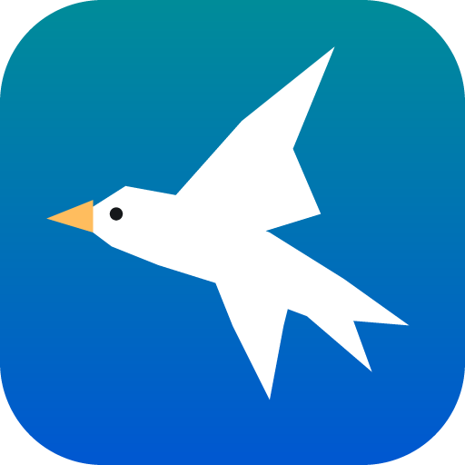

<p align="center">
  
</p>

<h1 align="center">Tern</h1>

<p align="center">Ứng dụng API client cho máy tính: gửi request, nối nhiều request thành flow, viết script và test. Mọi thứ lưu thành file thuần trên đĩa.</p>

Tern dùng để thử và kiểm tra API trong lúc phát triển backend: REST, GraphQL, gRPC và WebSocket trong cùng một giao diện. Không cần tài khoản, không đăng nhập, hoạt động hoàn toàn offline; dữ liệu và khóa API không rời khỏi máy.

<p align="center">
  
</p>

## Cách tổ chức

- **Application:** một dự án, tương ứng một thư mục trên đĩa. Một Application chứa nhiều Collection. Tên Application không được trùng nhau.
- **Collection:** một nhóm request liên quan với nhau, ví dụ một service gRPC hay một nhóm endpoint. Collection có thể lồng nhau.
- **Request:** một lời gọi cụ thể: một endpoint REST hoặc một method gRPC.
- **Flow:** một chuỗi request của một Application nối với nhau trên canvas (xem bên dưới).

Mọi Application nằm trong **một vị trí chung**, đặt ở Preferences, mục General. Mặc định là `%APPDATA%\tern` trên Windows. Khi tạo hoặc import Application bạn không phải chọn nơi lưu.

Application và Collection là thư mục chứa file văn bản (`.yml`), nên đưa vào Git cùng mã nguồn, review và merge như code.

## Chức năng

**Giao thức**

- HTTP/REST, GraphQL, gRPC, WebSocket.

**Soạn request**

- Params, headers, body (JSON, XML, form, multipart, file, ...), cookie. Cookie do server đặt được lưu và tự gửi kèm ở các request sau.
- Xác thực: nhiều kiểu auth (Basic, Bearer, API key, OAuth2, ...), đặt ở cấp Application hoặc Collection và kế thừa (`inherit`) xuống request.
- Environment dùng chung toàn app hoặc riêng từng Application; biến bí mật không bị ghi ra file.
- Sinh code mẫu (snippet) cho request.
- Cấu hình proxy, chứng chỉ client, bỏ qua kiểm tra SSL khi cần.

**Flow: nối request thành chuỗi**

Mở Flow từ menu của Application. Mỗi request là một node trên canvas:

- Kéo request từ danh sách bên trái vào canvas, rồi kéo dây từ một **status** của node (200, 201, 422, ...) sang request chạy tiếp theo. Status trả về quyết định đường đi; **Other** là lối ra cho mọi status không được liệt kê.
- Các status khai báo trong spec có sẵn trên node. Bạn tự thêm status khác bằng cách bấm chọn hoặc gõ mã. Mỗi dải có màu riêng: 2xx xanh, 3xx vàng, 4xx và 5xx đỏ.
- Mỗi node có bảng chi tiết để sửa param, header và body của request cho riêng flow đó.
- **Chia sẻ giá trị:** lấy một trường của response (ví dụ `data.user.username`) làm biến, dùng ở các request sau bằng `{{tên}}`. Nút `{ }` cạnh mỗi ô nhập, hoặc gõ `{{`, gợi ý các biến của những request đứng trước. Tên biến không được trùng nhau trong một flow.
- Chạy flow bằng nút Run. Node chuyển xanh khi thành công, đỏ khi lỗi; chọn node để xem status, thời gian, headers và body của response.
- Flow lưu trong file `flows.json` ngay trong thư mục của Application.

**Script và test**

- Script trước/sau request và test bằng JavaScript, chạy trong sandbox (QuickJS an toàn mặc định, hoặc chế độ developer).
- Assertion không cần viết code cho các kiểm tra thông thường.

**Tạo từ OpenAPI và Proto**

- Tạo Application gồm nhiều Collection; mỗi Collection lấy từ OpenAPI spec hoặc file `.proto`, bằng URL hoặc file.
- Đồng bộ từng Collection với OpenAPI spec theo chu kỳ (30 giây đến 30 phút). Bật Auto Reload thì endpoint được thêm, sửa, xóa tự áp dụng.
- **Reload application:** đồng bộ lại tất cả Collection của một Application chỉ với một lần bấm.
- Xem spec trong trình duyệt bằng Swagger UI.

**Quản lý**

- Application có màu riêng (16 màu hoặc màu tùy ý), dùng cho cả Collection bên trong.
- **Import** Application từ một thư mục hoặc một file `.zip`; **Export** cả Application thành một file `.zip`. Import trùng tên thì chọn giữ cái cũ, dùng cái mới hoặc đổi tên.
- Trang tổng quan của Application: số Collection, số request, Flow, và bảng Collection.
- Sidebar dạng cây theo tên máy, tab request, thanh menu có Preferences, Developer Tools và Cookies.
- Import và export Environment.
- Giao diện sáng và tối theo bảng màu Cyberdream, đổi giữa hai chế độ bằng hiệu ứng chuyển mượt.

## Cài đặt và chạy

Cần Node `v24.22.3` (xem `.nvmrc`).

```bash
npm i --legacy-peer-deps
npm run setup      # build các package dùng chung
npm run dev        # chạy Electron + React
```

Bản cài đặt cho Windows và Linux (AppImage, deb, rpm) được build bằng GitHub Actions mỗi khi có commit lên `main`, tải ở mục Releases.

## Cấu trúc mã nguồn

Monorepo (npm workspaces) trong `packages/`:

| Package                                                               | Vai trò                                            |
| --------------------------------------------------------------------- | --------------------------------------------------- |
| `app`                                                               | Giao diện React + Redux                            |
| `electron`                                                          | Tiến trình chính của Electron: file, mạng, IPC |
| `requests`                                                          | Gửi request (HTTP, gRPC, WebSocket)                |
| `js`                                                                | Sandbox chạy script và test                       |
| `filestore`                                                         | Đọc, ghi file `.yml`                            |
| `converters`                                                        | Chuyển đổi OpenAPI sang request                  |
| `common`, `schema`, `schema-types`, `query`, `graphql-docs` | Thư viện dùng chung                              |
