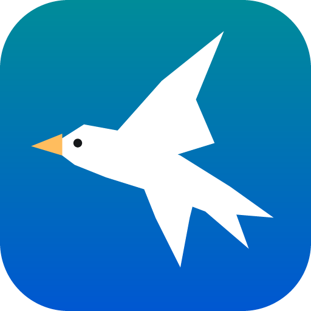

<p align="center">
  
</p>

<h1 align="center">Tern</h1>

<p align="center">Ứng dụng API client cho máy tính: gửi request, xem response, viết script và test. Mọi thứ lưu thành file thuần trên đĩa.</p>

Tern dùng để thử API nhanh trong lúc phát triển backend: REST, GraphQL, gRPC và WebSocket trong cùng một giao diện. Không cần tài khoản, không đăng nhập, hoạt động hoàn toàn offline; dữ liệu và khóa API không rời khỏi máy.

## Cách tổ chức

- **Application:** một dự án, tương ứng một thư mục trên đĩa. Một Application chứa nhiều Collection.
- **Collection:** một nhóm request (REST, GraphQL, gRPC, WebSocket) liên quan với nhau, ví dụ một service gRPC hay một nhóm endpoint. Collection có thể lồng nhau.
- **Request:** một lời gọi cụ thể: một endpoint REST hoặc một method gRPC.

Application và Collection là thư mục chứa file văn bản (`.bru` hoặc `.yml`), nên đưa vào Git cùng mã nguồn, review và merge như code.

## Chức năng

**Giao thức**

- HTTP/REST, GraphQL, gRPC và WebSocket.
- gRPC: nạp method từ file `.proto`; hỗ trợ unary và streaming.

**Soạn request**

- Params, headers, body (JSON, XML, form, multipart, file, ...), cookie.
- Xác thực: nhiều kiểu auth (Basic, Bearer, API key, OAuth2, ...), đặt ở cấp application hoặc collection và kế thừa (`inherit`) xuống request.
- Environment dùng chung toàn app hoặc riêng từng application; biến bí mật không bị ghi ra file.
- Sinh code mẫu (snippet) cho request.
- Cấu hình proxy, chứng chỉ client, bỏ qua kiểm tra SSL khi cần.

**Script và test**

- Script trước/sau request và test bằng JavaScript, chạy trong sandbox (QuickJS an toàn mặc định, hoặc chế độ developer).
- Assertion không cần viết code cho các kiểm tra thông thường.

**Tạo từ OpenAPI và Proto**

- Tạo Application gồm nhiều Collection; mỗi Collection lấy từ OpenAPI spec hoặc file `.proto`, bằng URL hoặc file.
- Đồng bộ từng Collection với OpenAPI spec theo chu kỳ (1 đến 60 phút) và xem trước thay đổi (thêm, sửa, xóa) trước khi áp dụng.
- Xem spec trong trình duyệt bằng Swagger UI.

**Quản lý**

- Trang Home dạng card hoặc bảng, sidebar dạng cây, tab request, tìm kiếm nhanh.
- Import Application có sẵn từ thư mục; import và export Environment.
- Chuyển định dạng Application từ `.bru` sang `.yml`.
- Nhiều theme sáng/tối.

## Cài đặt và chạy

Cần Node `v24.22.3` (xem `.nvmrc`).

```bash
npm i --legacy-peer-deps
npm run setup      # build các package dùng chung
npm run dev        # chạy Electron + React
```

Bản cài đặt cho Windows và Linux (AppImage, deb, rpm) được build bằng GitHub Actions mỗi khi có commit lên `main`, tải ở mục Releases.

## Cấu trúc mã nguồn

Monorepo (npm workspaces) trong `packages/`:

| Package | Vai trò |
|---|---|
| `app` | Giao diện React + Redux |
| `electron` | Tiến trình chính của Electron: file, mạng, IPC |
| `requests` | Gửi request (HTTP, gRPC, WebSocket) |
| `js` | Sandbox chạy script và test |
| `filestore`, `lang` | Đọc, ghi file `.bru` và `.yml` |
| `converters` | Chuyển đổi OpenAPI sang request |
| `common`, `schema`, `schema-types`, `query`, `sqlite`, `graphql-docs` | Thư viện dùng chung |
